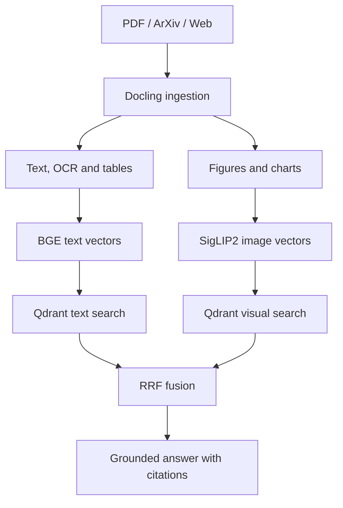

# Papeer — production RAG research assistant

Papeer answers questions over session-isolated PDF, ArXiv, text, Markdown, and
web sources. PDF results are returned as their original page-sized parent
document, so tables, figure captions, and surrounding multimodal page context
stay available to the answer model.

## Retrieval pipeline

`query → explicit metadata filters → 3 query variants → legacy dense + BM25 →
RRF candidates + multimodal candidates → global RRF/deduplication →
cross-encoder reranking → parent page context → cited answer`

- Child chunks are contextualized with title and page location while the source
  page stays intact as a parent document.
- All Qdrant reads are filtered by the anonymous browser session. The lexical
  BM25 stage operates only over that same session.
- The legacy hybrid text path always runs for uploaded-document questions.
  Multimodal text/visual search is an additional candidate source; a hit in one
  collection never suppresses the other collection or any query variant.
- Candidate evidence is normalized, globally fused deterministically,
  deduplicated by document/page identity, then reranked once. Captions and
  table text are reranked as text; visual-only evidence retains its fused rank
  without a fabricated description. Text may fill all requested results when
  no useful non-text evidence exists.
- A failure in multimodal retrieval falls back to complete hybrid text
  retrieval, and a text retrieval failure can still return session-filtered
  multimodal evidence. If both are empty, the graph continues through its
  existing abstention and corrective-routing flow.
- Every grounded answer includes stable `[S#]` citations with PDF page numbers
  or web URLs. It abstains when the retrieved sources cannot support a claim.

## LangGraph safeguards

The graph relevance-grades retrieved context, rewrites once when needed, then
uses Tavily as a bounded web fallback. Source text is explicitly isolated as
untrusted data in the answer prompt, preventing document-embedded instructions
from controlling tool use or the assistant.

## Guardrails

Papeer runs a layered, fail-closed guardrail pipeline built with
[NVIDIA NeMo Guardrails](https://github.com/NVIDIA/NeMo-Guardrails). The rails
live in `guardrails/` (`config.yml`, `rails.co`, and the custom actions in
`actions.py`); `backend/guardrails.py` calls the Groq-hosted safety models and
exposes the rails to the LangGraph graph, which stays the main workflow.

| Point | What runs | On a hit |
| --- | --- | --- |
| Input (new `input_guard` node, before the router; also `/btw`) | Llama Prompt Guard 2 (injection / jailbreak) and `gpt-oss-safeguard-20b` (unsafe content), in parallel | Polite refusal; no router, retrieval, Tavily or LLM call runs |
| Retrieval (inside the retrieval tool, `web_search`, `web_fallback` and claim verification) | Prompt Guard 2 on every chunk and Tavily result, split into overlapping windows that fit its 512-token limit | Chunk dropped and its source logged; the existing relevance grading, rewrite, web fallback and abstention handle what remains |
| Output (`generate_answer`) | `validate_citations()` removes citations that do not match retrieved evidence, then `gpt-oss-safeguard-20b` checks the answer | Answer withheld |

Llama Guard 4 was the original choice for content safety, but Groq
decommissioned `meta-llama/llama-guard-4-12b` on 5 March 2026 and recommends
`openai/gpt-oss-safeguard-20b`, which classifies against the policy in
`backend/guardrails.py`.

Every rail fails closed: a timeout, provider error or unreadable verdict blocks
the request with "please try again". Each call has a timeout and one retry on
429 / 5xx / timeouts. Logs contain verdicts, scores and source names, never the
question, document text or keys (NeMo's own text-bearing INFO logs are muted).

| Setting | Default | Purpose |
| --- | --- | --- |
| `GUARDRAILS_ENABLED` | `true` | One switch for all rails and citation validation; `false` restores the previous behaviour for local debugging |
| `GUARDRAIL_INJECTION_THRESHOLD` | `0.8` | Prompt Guard 2 score at or above which text is treated as an injection |
| `GUARDRAIL_TIMEOUT_SECONDS` | `10` | Per-call timeout for the guardrail models |
| `PROMPT_GUARD_MODEL` | `meta-llama/llama-prompt-guard-2-86m` | Injection / jailbreak classifier |
| `SAFETY_GUARD_MODEL` | `openai/gpt-oss-safeguard-20b` | Content-safety classifier |

On Groq's free tier `gpt-oss-safeguard-20b` is limited to 3 requests and 2,000
tokens per minute, roughly one to two questions a minute with input and
output checks. Use a paid tier for real traffic; otherwise the rails fail
closed and users see "please try again".

Evaluate the rails against the live models with:

```powershell
uv run python eval/run_guardrail_eval.py
```

It runs the 60 labelled cases in `eval/guardrail_cases.jsonl` (research
questions, direct injections, jailbreaks, unsafe requests, poisoned and clean
documents) through the graph's input and retrieval rails, prints the block
rate on harmful cases, the false-block rate on safe cases and the added
latency, and writes `eval/guardrail_results.json`. `--pace` spaces questions
to respect the safety model's rate limit.

## Portkey routing

Set `PORTKEY_API_KEY` to send every LLM call (router, retrieval expansion,
grading, rewriting, verification, and generation) through Portkey. Set
`PORTKEY_PROVIDER` to a saved Model Catalog provider such as
`@production-groq`. Production Portkey policies commonly block the inline
value `groq`; when no saved `@slug` is configured Papeer safely uses direct
Groq instead. `PORTKEY_CONFIG` is optional and can select a Portkey
retry/fallback/cache policy.

```powershell
Copy-Item .env.example .env
uv sync --group dev
uv run streamlit run app.py
```

Run checks with `uv run pytest -q` and `uv run ruff check backend app.py tests`.

## Multimodal and voice demo

Papeer is a production-style recruiter demo, not a claim of unlimited-scale
production hosting. It adds a typed multimodal ingestion path alongside the
existing, session-isolated text collection. Existing `papeer_chunks_v2` data is
never deleted or mutated; new elements use `papeer_multimodal_v1` with named
`text_dense` and `visual_dense` vectors.



- PDFs use Docling first for layout, table, and OCR-capable extraction. A
  controlled PyMuPDF fallback preserves text-only operation if Docling is
  unavailable. OCR is routed only for sparse native text, not indiscriminately.
- Each extracted item uses a stable content hash and a `DocumentElement` schema
  containing page, section, table/figure IDs, bounding box, extraction method,
  and optional asset key. Image bytes are kept out of Qdrant.
- Tables retain a Markdown form with headers. Text and visual candidates are
  fused deterministically with reciprocal-rank fusion, deduplicated, and
  globally reranked; multimodal indexing is optional and cannot prevent the
  reliable text document from being indexed.
- Streamlit's audio chat input uses Groq Whisper Turbo by default and Whisper
  Large V3 when the accuracy setting is enabled. Recordings are transcribed,
  shown for edit/confirm, and are not retained. The optional Read Answer
  control uses the browser's Web Speech API; it never auto-plays.
- Figure analysis is on-demand and uses Groq Llama 4 Scout only after visual
  retrieval. Its prompt requires visible-evidence JSON and explicit uncertainty.
  If it is unavailable, the UI must rely on caption/surrounding text instead.

### Run locally

```powershell
Copy-Item .env.example .env
uv sync --group dev
uv run streamlit run app.py
```

Set `GROQ_API_KEY`, `QDRANT_URL`, `QDRANT_API_KEY`, and `TAVILY_API_KEY` in
`.env`; never commit it. `ASSET_STORE=local` works without object-storage
credentials. For Cloudflare R2, set `ASSET_STORE=r2` plus every `R2_*` setting.
The full variable list and safe defaults are in `.env.example`.

### Streamlit Community Cloud

1. Push this repository (without `.env`) and create an app pointed at `app.py`.
2. Add the required values above in the app's Secrets UI, plus optional R2
   settings only if using R2.
3. Keep optional model flags enabled only when the deployment has enough CPU,
   memory, and provider quota. Models are loaded lazily; first visual retrieval
   can be slow on free hosting.

The application enforces 20 MB files, 40 PDF pages, 30 figures, 10 MB audio,
five URLs, local single-flight ingestion, filename/MIME checks, temporary-file
cleanup, strict HTTPS public URL checks, and session filters on every new
multimodal vector query. It does not log keys, raw recordings, or complete
private document contents.

### Evaluation and limitations

`tests/test_multimodal.py` covers canonical schemas and IDs, file validation,
OCR routing, table serialization, figure filtering, RRF, deduplication,
diversity, citations, speech cleanup, and tenant filters. Provider integration
tests are intentionally not run without credentials or downloaded models, so no
performance, faithfulness, or OCR-accuracy metric is claimed here. Add a small
fixture corpus before reporting Recall@k, MRR/nDCG, latency, citation-validity,
or answer-faithfulness values.

Good demo questions include: “Summarize the method on page 4,” “What does
Table 2 compare?”, “Which chart supports the reported trend?”, and “What is
insufficiently supported by this paper?” Web results are supplementary and are
not represented as uploaded-paper evidence.
